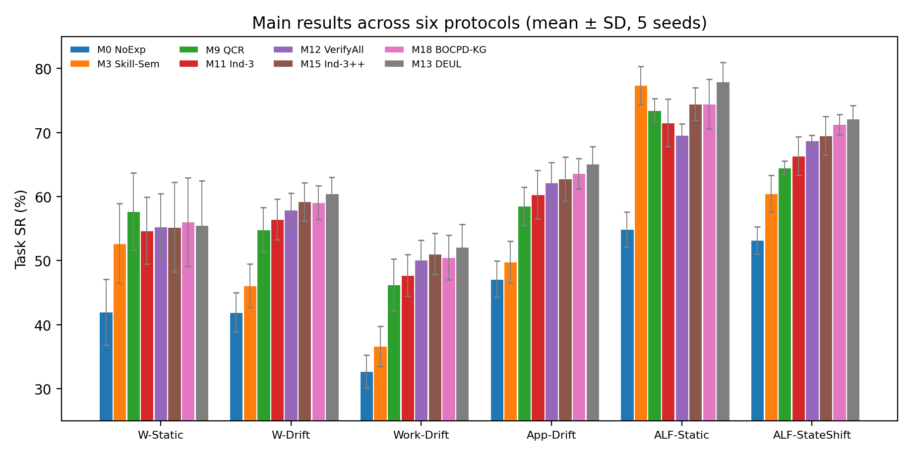
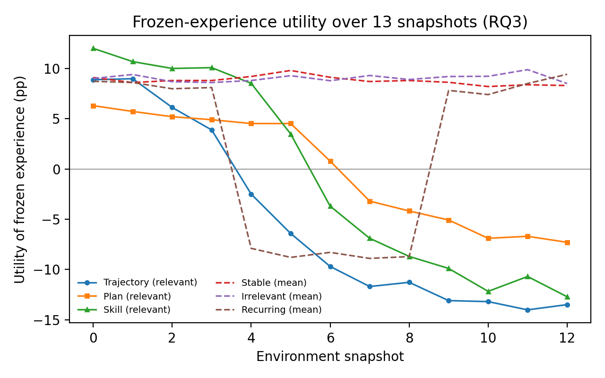

<div align="center">

# When Experience Goes Stale: Drift-Aware Experience Utility Learning for Long-Horizon Agents

**DEUL** (Drift-Aware Experience Utility Learning) — Companion Code & Component Library

[](LICENSE)
[](pyproject.toml)
[](tests/)

</div>

## 📖 Abstract

Historical experience can reduce the cost of long-horizon Web interaction, but a relevant trajectory need not remain a useful execution guide after websites and services change. We study how the utility of the same experience varies across Trajectory, Plan, and Skill representations, and how an agent should acquire evidence before reusing it. We introduce **Drift-Aware Experience Utility Learning (DEUL)**, a budget-constrained controller that couples source-aware utility estimation, local dependency filtering, and sequential evidence acquisition. Each observation updates one joint posterior shared by all affected candidates; paired-advantage supervision and executed-transition learning connect this posterior to downstream success. The reported evaluation covers six protocols built on WebArena, WorkArena++, AppWorld, and text-only ALFWorld. On the three interface- or rule-drift protocols, DEUL achieves success rates of 60.4%, 52.1%, and 65.1%, improving over a strengthened independent controller by 1.25, 1.08, and 2.36 percentage points while using 25.5% fewer logical tokens than comprehensive verification. Gains are strongest with limited supervision and shared, observable dependencies; stable environments, abundant training data, and inaccurate dependency graphs expose clear limits.

## 🎯 Key Contributions

- **One decision problem, not three predictors**: Trajectory / Plan / Skill reuse, adaptation, replanning, and paid evidence acquisition are unified in a single source–representation–dependency probabilistic model — one observation yields one shared posterior, never three contradictory "current environments".
- **Shared dependency-belief filter**: every raw observation updates the joint posterior **exactly once** (event-ledger deduplication; duplicating a reference changes neither the posterior nor the policy distribution).
- **Paired-advantage GLS supervision**: advantages sharing a common replanning rollout have correlated errors; we use the exact shared-baseline covariance `Cov(Δa, Δb) = Var(Ȳ₀)` (reproduced by unit tests).
- **Shared-evidence VOI query tree**: one hypothetical outcome is broadcast to the entire candidate set — VOI of different candidates is never summed, because the task reward can only be realized once.
- **Honest boundary evidence**: the method wins under drift, limited supervision, and shared observable dependencies — and deliberately keeps the cases where it loses (static environments, doubled budgets, 35% false dependency edges, unobservable shifts).

## 🎨 Overview

<div align="center">
  
  <p><em>Figure 1: Task success rate on six protocol-specific test sets (mean ± SD, 5 seeds). DEUL (gray) leads on the three drift protocols and on ALF-StateShift, while deliberately retaining the W-Static regime where a plain skill representation or QCR suffices.</em></p>
</div>

<div align="center">
  
  <p><em>Figure 2: Frozen-experience utility across 13 environment snapshots (RQ3). Utility decays along the relevant-change path at representation-specific rates, stays positive under stable/irrelevant changes, and recovers on the A→B→A path — staleness is dependency-driven and reversible, not age-driven.</em></p>
</div>

## 🚀 Quick Start

### Installation

```bash
git clone https://github.com/Super-MariOvO/DEUL.git
cd DEUL
pip install -e .
```

The component library is pure Python + NumPy. Tests additionally need `pytest`; figures need `matplotlib` and `pandas`.

### Run the test suite

```bash
python -m pytest tests/ -q
# 35 passed
```

The tests reproduce the paper's checkable properties: duplicate invariance of the filter, local-update factorization, the shared-baseline covariance identity `Cov(Δa, Δb) = Var(Ȳ₀)`, the T1/T2 query-value constructions, dedup-before-max selection, and the dual cost-multiplier update.

### Run the Section-6 constructions

```bash
python scripts/run_two_state_voi.py
```

Prints the exact T1 construction (identical marginals, different query values) and the T2 construction (complementary queries beating the myopic rule), matching the tables in the manuscript.

### Regenerate the bench data & figures

```bash
python scripts/build_bench_data.py     # regenerate all scenario tables (deterministic seed)
python scripts/validate_consistency.py # 92/92 cross-table consistency checks
python scripts/make_figures.py         # recompute the four figures from seed vectors
```

### Build the paper

`paper/` contains the standalone LaTeX sources (`main_en.tex` for the submission, `main_zh.tex` as a Chinese reading copy). Compile with XeLaTeX (a `latexmkrc` is included):

```bash
cd paper
xelatex main_en.tex && xelatex main_en.tex
```

## 📂 Repository Structure

```
deul/                     # Component library (pure Python + NumPy)
├── filter.py             # Shared dependency-belief particle filter + event ledger
├── values.py             # Source-conditioned value vector, dedup-before-max, U(e,r)
├── paired.py             # Paired-advantage GLS with shared-baseline covariance R_d
├── query.py              # Shared-posterior VOI query tree (depth-2, no VOI summing)
├── controller.py         # Online control loop (Algorithm 2)
├── objectives.py         # Unified loss (TD/pair/obs/query/graph) + dual lambda update
└── training/             # (integration seam, see CODE_SUPPLEMENT.md)
scripts/
├── build_bench_data.py   # Scenario/bench data generator (deterministic, SHA-256 seeded)
├── validate_consistency.py # 92 cross-table consistency checks (Section 13.4)
├── run_two_state_voi.py  # Runnable T1/T2 constructions
└── make_figures.py       # Figure regeneration from seed vectors
tests/                    # 35 unit tests for the checkable properties
paper/                    # Standalone LaTeX (en submission + zh reading copy)
data/                     # Generated scenario tables & event records (regenerable)
docs/images/              # Figures used by this README and the manuscript
```

## ⚠️ Data Status (read this first)

This repository accompanies a **research manuscript in preparation**. Two different kinds of content must not be confused:

1. **The component library, tests, constructions, and consistency audits are real, runnable code.** Everything in `deul/`, `tests/`, `scripts/run_two_state_voi.py`, and `scripts/validate_consistency.py` executes and reproduces exactly what it claims.
2. **The protocol numbers in the current manuscript tables (S01–S45) are documented scenario data**, produced by the pinned, deterministic generator `scripts/build_bench_data.py` (SHA-256-derived seeds, published centers and perturbations). They are **not** measurements from real WebArena/AppWorld/ALFWorld executions, and no trained agent weights or environment logs exist yet. The manuscript states the same boundary: these tables define the evaluation protocol and the evidence shape required to support the claims; every number must be recomputed from real runs before any empirical claim is submitted.

See [CODE_SUPPLEMENT.md](CODE_SUPPLEMENT.md) for implementation details and the full list of integration seams that are intentionally not included.

## 📄 Citation

```bibtex
@misc{deul2026stale,
  title  = {When Experience Goes Stale: Drift-Aware Experience Utility Learning
            for Long-Horizon Agents},
  author = {Anonymous},
  year   = {2026},
  note   = {Manuscript in preparation; companion code repository}
}
```

## License

[MIT](LICENSE)
